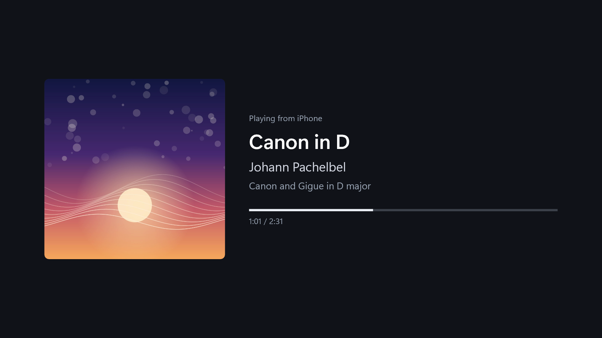
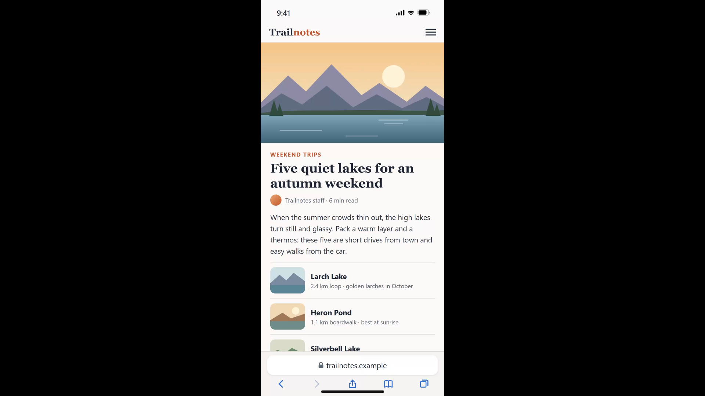
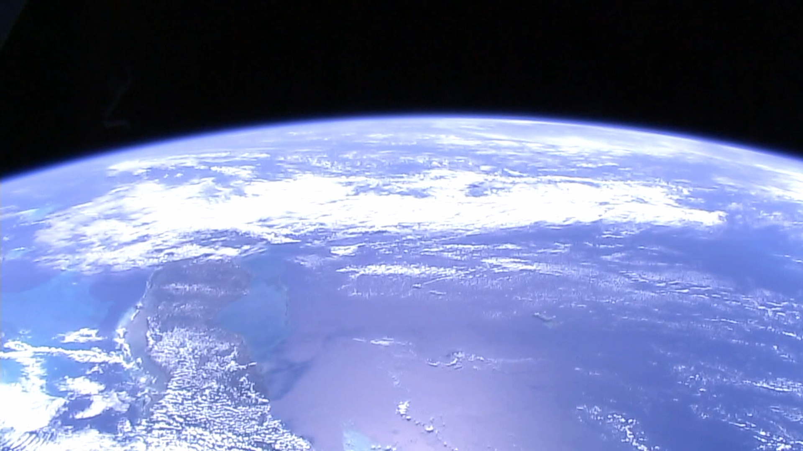

# Screen Mirror Server

An AirPlay receiver for Xbox One: mirror an iPhone or iPad to the TV, play music to it, or cast
videos to it. It is a UWP port of [UxPlay](https://github.com/FDH2/UxPlay): UxPlay's protocol
library does the AirPlay work, and the console's own media stack does the decoding (H.264 in
hardware, plus XAudio2 and the platform's adaptive streaming player).

| What you do on the iPhone | What the Xbox does |
|---|---|
| Control Center → Screen Mirroring → **Xbox One** | Mirrors the screen with sound; follows rotation |
| AirPlay button in Music, Spotify, a podcast app… → **Xbox One** | Plays the audio (Apple Lossless) with title, artist, album, cover art and progress |
| "Tap to AirPlay" / AirPlay button in YouTube or a web video → **Xbox One** | Plays the video itself (HLS or direct links); play/pause/seek from the phone |

The phone's volume buttons control the volume in every mode.

| Music | Screen mirroring (portrait) | Video |
|---|---|---|
|  |  |  |

**Limitations.** DRM-protected apps (Apple TV+, Netflix, Disney+…) only cast to Apple-certified
receivers. Videos the original Xbox One cannot decode (HEVC, VP9, AV1) are skipped or fail. Like
any UWP app it receives only while it is open: the console suspends it a few seconds after you
switch away, and it reappears on the phone as soon as you open it again. In the YouTube app, the
video starts about 10 seconds after an ad ends, on the ad's last picture (the "Skip" button starts
it at once); see TODO in `docs/DEVLOG.md`.

## Install

- **Microsoft Store** (retail mode): see "Publishing" below; the reference build is published
  with a private audience.
- **Developer Mode**: build the sideload package (below) and install it with
  `tools/deploy.sh`, or in a browser through Xbox Device Portal
  (`https://<xbox-ip>:11443` → *Home → Add*: the `.msix` from
  `build/AppPackages/ScreenMirrorServer_<version>_x64_Test/` plus
  `Dependencies/x64/Microsoft.VCLibs.x64.14.00.appx`). An Xbox profile must be signed in to launch it.

## Settings

Files in the app's `LocalState` folder (Device Portal → File explorer → LocalAppData →
`vpro8725.ScreenMirrorServer_...` → LocalState):

- `name.txt`: the receiver name shown on the iPhone (one line; default "Xbox One", or
  "<computer name> (PC)" when run on a PC).
- `debug.txt`: if present, the log includes every protocol request and the idle screen shows the
  latest log lines.
- `airplay.log` / `airplay.prev.log`: logs of the current and previous run. If the app crashes,
  the log ends with `CRASH:` lines; `tools/xbox.sh log airplay.prev.log | grep CRASH |
  tools/symbolize.sh` turns their `exe+0x...` addresses into function names (using the linker map
  of the same build).
- `device_id.txt`: the receiver identity; delete it to look like a new device to iPhones.

## Building

1. Visual Studio 2022 Build Tools with the *Desktop development with C++* and *UWP build tools*
   workloads plus the *C++ (v143) Universal Windows Platform tools* component, and the
   Windows 11 SDK (10.0.26100):
   ```
   winget install Microsoft.VisualStudio.2022.BuildTools --override "--passive --wait --add Microsoft.VisualStudio.Workload.VCTools --add Microsoft.VisualStudio.Workload.UniversalBuildTools --add Microsoft.VisualStudio.ComponentGroup.UWP.VC.BuildTools --add Microsoft.VisualStudio.Component.VC.Tools.x86.x64 --add Microsoft.VisualStudio.Component.Windows11SDK.26100 --addProductLang En-us"
   ```
2. In Git Bash:
   ```bash
   git clone --recurse-submodules <this repo>
   bash tools/setup-deps.sh          # vcpkg: OpenSSL, libplist, FFmpeg (libavcodec), test-tool libraries
   bash tools/make-test-cert.sh      # signing key for Developer Mode packages (not committed)
   cmd.exe //c "tools\\build-app.cmd Release"   # sideload package -> build/AppPackages
   cmd.exe //c "tools\\build-store.cmd"         # Store upload package (.msixupload)
   cmd.exe //c "tools\\build-tests.cmd"         # desktop test sender -> build/tests
   ```
3. Put the console's Device Portal address in `tools/xbox-address.txt` (e.g.
   `https://192.168.1.50:11443`) to use `tools/deploy.sh` (bump version, build, install, launch)
   and `tools/xbox.sh` (install, launch, logs, screenshots).

## Publishing (retail Xbox)

Retail consoles only run Store apps. The app is published as a non-game UWP app through
[Partner Center](https://partner.microsoft.com/dashboard) (individual registration is free):
reserve a name, copy the identity from *Product identity* into `src/app/Package.appxmanifest`,
build with `tools/build-store.cmd`, and submit with *Private audience* visibility, category
*Utilities & tools*, Xbox as the device family, and `PRIVACY.md` as the privacy policy URL. Tell
the certification testers how to try it (an iPhone on the same network → Screen Mirroring).
`docs/store/listing.md` has the text for every Store listing field, and `docs/store/art` the
listing images (made by `tools/store/make-store-art.ps1` from the app's mark in `tools/glyph.ps1`,
which `tools/make-assets.ps1` also uses for the package tiles).

## Testing without an iPhone

`build/tests/fakesender.exe` plays the iPhone's side of the protocol (pairing, FairPlay, RTSP,
encrypted streams), so each mode can be exercised on a console from a PC:

```bash
build/tests/fakesender.exe <xbox-ip> --seconds 30 --rotate-at 10         # mirroring: frame counter + tone
build/tests/fakesender.exe <xbox-ip> --image page.png --size 888x1920    # mirroring a picture, portrait
build/tests/fakesender.exe <xbox-ip> --speaker --audio-file song.flac    # speaker mode (ALAC + tags, cover art)
build/tests/fakesender.exe <xbox-ip> --speaker --corrupt-every 25        # damaged audio packets must not crash
build/tests/fakesender.exe <xbox-ip> --cast-url <video or .m3u8 url>     # web-video style casting
build/tests/fakesender.exe <xbox-ip> --cast-hls <master .m3u8 url>       # YouTube-style casting
build/tests/fakesender.exe --discover                                    # mDNS check
```

Run it without arguments for all options. Its audio is ALAC in every mode: an iPhone sends
AAC-ELD while mirroring, but no free AAC-ELD encoder can be combined with GPL code, so that
decoder is exercised with a real iPhone.

The Store screenshots come from `tools/demo/capture-screenshots.sh`, which drives these sessions on
a Dev Mode console with media generated for the project (see `tools/demo/`).

## Layout

- `src/app/`: the UWP app (C++/WinRT, XAML built in code)
  - `AirPlayService`: owns the UxPlay library and routes its callbacks
  - `VideoRenderer`: mirrored H.264 → MediaStreamSource → MediaPlayer (hardware decoding);
    `H264Sps` rewrites the stream header so that frames are shown as soon as they are decoded
  - `AudioRenderer`: AAC-ELD and ALAC (`AudioDecoder`, FFmpeg) → XAudio2
  - `CastPlayer`: AirPlay video (direct URLs and HLS) → MediaPlayer / AdaptiveMediaSource;
    `HlsAudio` rewraps HLS packed audio (YouTube's audio tracks) as MPEG-TS
- `src/airplay/`: UxPlay's `lib/` with the changes listed in `docs/uxplay-lib-changes.patch`
- `src/compat/`: pthread/unistd shims for MSVC
- `third_party/UxPlay`: upstream UxPlay (submodule)
- `test/fakesender/`: the test sender; `test/h264sps/`, `test/hlsaudio/`: checks of the H.264 header
  rewrite and the packed-audio conversion against FFmpeg (`build/tests/*_test.exe`)
- `tools/`: build, dependency, deployment and Device Portal scripts; `tools/demo/`: screenshot media;
  `tools/store/`: Store listing art
- `docs/store/`: Store listing text and art
- `docs/DEVLOG.md`: how it was built and tested, and what changed in UxPlay's code

## License

GPL-3.0, as UxPlay. See `LICENSE`, `THIRD_PARTY_NOTICES.md` and `PRIVACY.md`.
"AirPlay", "iPhone" and "iPad" are trademarks of Apple Inc.; this project is not affiliated with
Apple or Microsoft.
